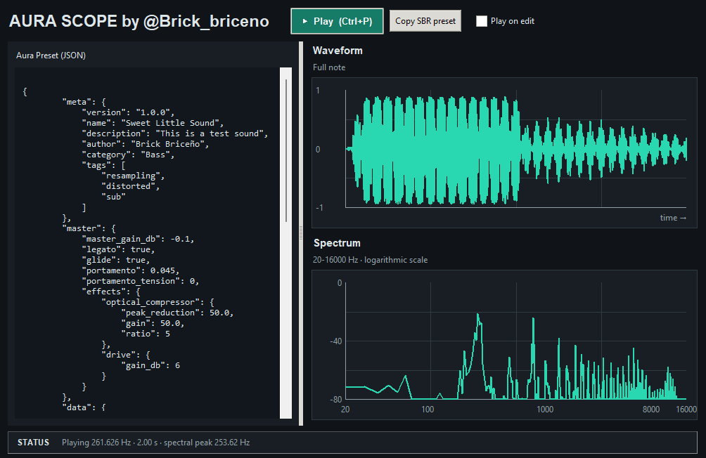

# Aura class documentation

## Overview

`Aura` is the high-level synthesis engine used by the Bsound system. Instead of composing notes manually in arrays, the class loads a declarative preset, resolves its formulas, renders audio nodes, applies effects, and returns a stereo note

This system is designed to be a preset-driven synth layer: the user defines a sound in structured JSON-like Python dictionaries, and `Aura` compiles it into audio

  
**You can find this Aura IDE in Bsound/Aura_IDE.py**  
You can even generate the code for using the sound in SBR by copying the code and pasting it into main.sm

## Responsibilities of the class

`Aura` is responsible for:

- loading presets from Python dicts, compressed bytes, or BaseX strings
- validating the preset schema
- resolving internal variable expressions
- generating oscillator and envelope data
- merging outputs into stereo audio
- applying master effects
- exporting the preset in different binary/text formats

## Relevant file

- [Aura.py](B:/BrickData/SBR/Bsound/Aura.py)

## Main class

```python
class Aura:
    def __init__(self, preset: bytes | dict | str, cache=True):
```

## Constructor behavior

```python
synth = Aura(preset_example)
```

The constructor accepts three valid preset input types:

- `dict`: already loaded preset object
- `bytes`: compressed JSON preset
- `str`: BaseX-encoded preset string

#### BaseX?

It is a format designed specifically for Aura presets

### Input validation

During initialization, the class verifies:

- `meta` exists and is a dict
- `meta.name`, `meta.version`, `meta.description`, `meta.author`, `meta.category` are strings
- `meta.tags` is a non-empty list
- `master` exists and is a dict
- `master` contains required keys such as `master_gain_db`, `legato`, `glide`, and `portamento`
- `data` exists and is a non-empty dict
- `out` exists and is a non-empty list

If something is invalid, it raises `AURA_ERROR`

## Internal state

`Aura` stores the following important attributes:

- `self.preset`: the validated preset dictionary
- `self.last_note`: last note frequency used
- `self.cache`: whether note reuse through caching is enabled
- `self.arrays_bank`: cache of previously computed notes

## Core generation method

### `get_note(note_hz=261.626, duration=4, velocity=.8, gain_db=-.1) -> np.ndarray`

This is the central method. It generates a note from the preset and returns a stereo audio buffer

### Parameters

- `note_hz`: fundamental frequency in Hz
- `duration`: note length in seconds
- `velocity`: note intensity scale factor
- `gain_db`: final gain to apply, in dB

### Return

Returns a NumPy array with shape `(samples, 2)`, meaning stereo audio

### Internals

`get_note()` performs the following pipeline:

1. Reads and validates master settings such as gain, glide, and portamento
2. Computes pitch glide when `glide` is enabled and a previous note exists
3. Builds a context with variables like:
   - `note_hz`
   - `note_number`
   - `octave`
   - `duration`
   - `duration_progress`
   - `velocity`
   - `glide`
   - `portamento`
4. Resolves each node stored in `preset['data']`
5. Evaluates formulas and arrays safely
6. Converts every output node to stereo
7. Sums the output nodes into a single mixed output
8. Applies master effects
9. Stores the result in cache if enabled
10. Applies the final gain offset and returns the result

### Example

```python
synth = Aura(preset_example)
audio = synth.get_note(note_hz=440.0, duration=1.5, velocity=0.9, gain_db=-1.5)
```

## Using Aura instruments in SBR

Aura presets can be registered as SBR instruments using the `instrument` form
generated by `get_SBR_string_preset`

SBR keeps the `Instrument` instance with each synthesized note event, and uses
the existing note, duration, velocity, position, and panning metadata to render
it through Aura

The SBR chromatic note number maps directly to Aura's note-number convention,
where `0` is C0 and `57` is A4, SBR converts this note number to Hz before
calling `get_note`

Note durations are passed to Aura in seconds, and note velocity is passed as
the Aura velocity parameter, synthesized notes are not scaled by velocity a
second time in the mixer

Aura returns stereo audio at `SAMPLE_RATE`, which is mixed with sample-based
instruments by Bsound, Aura's preset master gain and effects remain part of the
rendered note

Rhythm-only SBR events do not carry a note duration, synthesized rhythm events
use one SBR timing step, `15 / tempo`, as their render duration

Each SBR instrument reuses its Aura instance, so glide state follows event
rendering order, simultaneous notes share that state and do not have independent
per-voice portamento

### Built-in pluck instrument

SBR includes `$pluck`, a piano-like plucked sound built from a fundamental and
three slightly inharmonic sine partials, each with its own decaying envelope,
for a sharp attack and a naturally fading tone

```sbr
play Struct{$pluck; V0.8; Sm{B1; M1}}
```

## Preset format

A valid preset is a dictionary with at least the following structure:

```python

preset_example = {
    "meta": {
        "version": "1.0.0",
        "name": "Example Preset",
        "description": "An example preset for demonstration purposes",
        "author": "Brick Briceño",
        "category": "Bass",
        "tags": ["resampling", "distorted", "sub"],
        "description": "Heavy wavetable bass with OTT style dynamics and fast LFO",
        },

    "master": {
        "master_gain_db": -0.1,
        "legato": True,
        "glide": True,
        "portamento": .045, #this is the time in seconds for the glide effect
        "portamento_tension": 0, # this goes from -1 to 1
        "effects": {
            # Add compression
            "optical_compressor": {
                "peak_reduction": 50.0,
                "gain": 50.0,
                "ratio": 5,
            },
            "reverb": {
                "room_size": 0.98,
                "wet_level": 0.35,
                "dry_level": 0.65,
                "width": 1.2,
            },
        },
    },

    # Variables (They can be used as parameters for automations, LFOs, and envelopes)
    # inside variables you can use mathematical operators to create complex modulation

    # "note_hz", example: "note_hz * 2" for an octave above

    # "note_number", example: "note_number + 12" for an octave above
    # it can also be used to control the intensity of a parameter
    # for example, if you want fewer harmonics in the treble
    # you can use "note_number / 127" to control the number of harmonics

    # "octave" is note_number / 12
    # "glide" is the pitch-ratio array for the current note

    # "duration" is a constant indicating how long it lasts, expressed in seconds
    # "duration_progress" is an array progressing from 0 to duration in seconds

    # "velocity" put this variable after a "1-" and connect it to the ADSR attack
    # it will sound softer if you play more gently and stronger if you play hard, like a real instrument
    # "1-velocity" (goes from 1 to 0) and not the other way around

    # "portamento" (goes from 0 to 1) in how long it takes to complete the glide

    "data": {
        # oscillators, ADSR envelopes, and LFOs are defined in this dictionary
        # there are only 2 data types: numbers and arrays
        # and all are valid in all effect, oscillator, and LFO inputs

        # This "osc1" is optional; you can easily name it "papi rupi" if you want
        # this works like variables that store waveforms with values you can place anywhere else
        # and be careful: a variable name for the oscillator, envelope, or anything else stored in "data"
        # cannot match an effect name or any reserved word
        # the standard is to call oscillators "oscX"
        # and envelopes "envX", sometimes with an additional description
        "osc1": {
            # Available waveform types: sine, square, sawtooth, triangle, noise, silence
            "waveform": "square",
            "frequency": "note_hz * vibrato",
            "amplitude": "velocity * env1",
            "stretch": "duration_progress ",
            "duration": "duration",
            "effects": {
                "drive": {
                    "gain_db": 20,
                    "normalize": True,
                },
            },
        },
        "vibrato": {
            "waveform": "square",
            "frequency": 8,
            "amplitude": "duration_progress * .5",
            "stretch": 0,
            "duration": "duration",
        },
        "env1": {
            # All oscillators/envelopes must have a "waveform" or a "DAHDSR_envelope"
            # The compiler will look for one or the other to find other parameters
            "DAHDSR_envelope": {
                # Delay before the envelope starts, in seconds (>= 0)
                "delay": 0,
                # Attack duration until the envelope reaches its maximum, in seconds
                # This can easily be "1.125 - velocity * 1.1"
                # so it has less attack if played harder
                "attack": 0.25,
                # Time held at maximum level before decay, in seconds
                "hold": 0.2,
                # Duration of the fall from maximum to sustain level, in seconds
                "decay": .5,
                # Sustain amplitude in [0, 1]; 1 is maximum and 0 is silence
                "sustain_level": 0.5,
                # Duration of the sustain phase, in seconds
                "sustain": 0.5,
                # Duration of the release from sustain level to silence, in seconds
                "release": 2,

                # Attack curve tension in [-1, 1]: positive rises faster initially
                "attack_tension": 0.25,
                # Decay curve tension in [-1, 1]
                "decay_tension": -0.25,
                # Release curve tension in [-1, 1]
                "release_tension": 0.25,
            },
        },
    },

    # Not all oscillators need to be routed to the master output
    "out": [
        "osc1",
        ]
},


```

## `meta` section

The `meta` object contains metadata for the preset itself

Required entries:

- `version`: preset version
- `name`: preset display name
- `description`: human-readable description
- `author`: author name
- `category`: category such as `Bass`, `Lead`, `Pad`, etc
- `tags`: list of tags

These values are validated as strings or a non-empty list

## `master` section

The `master` section defines note-wide behavior and final processing

Important keys:

- `master_gain_db`: global gain offset in dB
- `legato`: feature toggle for legato behavior
- `glide`: whether portamento/glide is enabled
- `portamento`: transition time for the glide in seconds
- `portamento_tension`: tension shape of the glide, in `[-1, 1]`
- `effects`: object containing post-mix effect definitions

## `data` section

The `data` section is the heart of the synth. It contains the synthesis graph

A node can be:

- an oscillator definition
- an envelope definition
- a numeric constant
- an array
- a formula expression

### Oscillator node

Example:

```python
"osc1": {
    "waveform": "square",
    "frequency": "note_hz * vibrato",
    "amplitude": "velocity * env1",
    "stretch": "duration_progress",
    "duration": "duration",
    "effects": {
        "drive": {"gain_db": 20, "normalize": True}
    }
}
```

### Envelope node

Example:

```python
"env1": {
    "DAHDSR_envelope": {
        "delay": 0,
        "attack": 0.25,
        "hold": 0.2,
        "decay": 0.5,
        "sustain_level": 0.5,
        "sustain": 0.5,
        "release": 2,
        "attack_tension": 0.25,
        "decay_tension": -0.25,
        "release_tension": 0.25,
    }
}
```

The envelope generator uses the `Envelopes.DAHDSR_envelope()` helper to produce a one-dimensional amplitude curve

## Supported oscillator waveforms

The waveform resolver supports:

- `sine`
- `square`
- `sawtooth`
- `triangle`
- `noise`
- `silence`

These values are checked and if not supported, `AURA_ERROR` is raised

## Expression system

Aura is able to evaluate strings such as:

```python
"note_hz * vibrato"
"velocity * env1"
"note_number / 127"
"duration_progress * 0.5"
```

This is done through a restricted AST-based evaluation pipeline

### Important details

The system:

- replaces complete variable names without accidental partial matches
- prevents collisions between names such as `env1` and `env10`
- validates allowed arithmetic nodes
- rejects unknown variables
- limits expression complexity and exponent magnitude
- aligns array lengths for simultaneous modulation

Internally the following helpers are used:

- `_replace_preset_names()`
- `_validate_preset_expression()`
- `_align_preset_arrays()`
- `_maths()`

This provides a safer evaluation model than raw `eval()` on arbitrary strings

## Effects available in `master.effects`

Effects are dictionaries whose keys are effect names and whose values are parameter dictionaries
They can be placed in `master.effects` to process the mixed output or inside an oscillator's `effects` object to process that oscillator
An effect with no parameters can use an empty object or the value `true`

```json
"effects": {
    "drive": {
        "gain_db": 20,
        "normalize": true
    }
}
```

Formula strings and arrays can be used as effect parameter values when the effect supports array-valued parameters

### `drive`

Applies soft-clipping distortion using a hyperbolic tangent

Parameters:

- `gain_db`: input drive in decibels, defaults to `1.0`; the implementation also accepts the function parameter name `gain_dbs`
- `normalize`: when `true`, scales the result so its peak reaches 1; defaults to `false`

```json
"drive": {
    "gain_db": 20,
    "normalize": true
}
```

### `bit_crush`

Reduces the number of amplitude steps and can hold samples to imitate a lower sample rate

Parameters:

- `bit_depth`: quantization depth in bits, defaults to `8`; values below 2 are invalid and values are rounded to an even number
- `mix_wet`: blend from the original signal at `0` to the crushed signal at `1`, defaults to `1` and must be in the range `[0, 1]`
- `sample_rate_reduction`: frame-hold factor, defaults to `1`; `4` holds each captured frame for about four input frames and values must be at least `1`

Each parameter can be a scalar or an array with one value per audio frame

```json
"bit_crush": {
    "bit_depth": 8,
    "mix_wet": 0.85,
    "sample_rate_reduction": 4
}
```

### `valve_distortion`

Models a 12AX7 tube stage with four-times oversampling

Parameters:

- `gain_db`: input drive in decibels, defaults to `20`
- `normalize`: when `true`, normalizes the processed signal peak; defaults to `false`
- `high_pass_filter`: when `true`, enables the internal 27.5 Hz high-pass filter; defaults to `true`

```json
"valve_distortion": {
    "gain_db": 20,
    "normalize": false,
    "high_pass_filter": true
}
```

### `optical compressor`

Both names call the same LA-2A-style optical compressor and tube processor

Parameters:

- `peak_reduction`: sidechain drive control from `0` to `100`, defaults to `50`; higher values increase compression
- `gain`: output make-up control from `0` to `100`, defaults to `50`; the implementation maps this control to as much as approximately 40 dB of make-up gain
- `ratio`: compression ratio, defaults to `5`

```json
"optical": {
    "peak_reduction": 50.0,
    "gain": 50.0,
    "ratio": 5
}
```

### `br11ck67_analog`

Applies a FET-style compressor and analog saturation with configurable oversampling

Parameters:

- `input_db`: input gain in decibels, defaults to `12`
- `output_db`: output gain in decibels, defaults to `-6`
- `attack_ms`: attack time in milliseconds, defaults to `0.2`
- `release_ms`: release time in milliseconds, defaults to `300`
- `ratio`: compression ratio, defaults to `4`
- `all_buttons_in`: enables the all-buttons mode when `true`; defaults to `false`; this mode sets the ratio to `100`, attack to `0.02` ms and adds 6 dB of input gain
- `oversampling`: oversampling factor; supported values are `1`, `2`, `4` or `8`, with `4` as the default

```json
"br11ck67_analog": {
    "input_db": 12,
    "output_db": -6,
    "attack_ms": 0.2,
    "release_ms": 300,
    "ratio": 4,
    "all_buttons_in": false,
    "oversampling": 4
}
```

### `reverb`

Adds a stereo Schroeder-style reverberation tail

Parameters:

- `room_size`: feedback amount that controls decay; defaults to `0.92` and must be less than `1`
- `wet_level`: gain applied to the reverberated signal, defaults to `0.45`
- `dry_level`: gain applied to the original signal, defaults to `0.55`
- `width`: stereo spread that offsets the right-channel delay lines, defaults to `1.5`
- `tail_db`: target level used to estimate the tail length, defaults to `-60` dB and must be no greater than `0`

```json
"reverb": {
    "room_size": 0.92,
    "wet_level": 0.45,
    "dry_level": 0.55,
    "width": 1.5,
    "tail_db": -60
}
```

### `stereo_expander`

Splits a mono signal into 32 frequency bands and alternates their stereo positions

Parameters:

- `mix`: blend from the dry mono signal at `0` to the expanded stereo signal at `1`, defaults to `0.5`
- `start_in_hz`: lowest band-center frequency in hertz, defaults to `180`

This effect accepts a mono signal

```json
"stereo_expander": {
    "mix": 0.5,
    "start_in_hz": 180
}
```

### `delay`

Adds repeated stereo echoes to the original signal

Parameters:

- `input_gain`: gain in decibels applied successively to each echo, defaults to `-6`
- `times`: list of intervals in seconds between the original signal and each successive echo, defaults to `[1.5, 1.5, 2, 1, 2]`
- `pan`: echo balance from full left at `-1` to full right at `1`, defaults to `0.12`
- `ping_pong`: when `true`, alternates the pan direction on each echo; defaults to `true`
- `offset`: channel offset in seconds; positive values delay the right channel and negative values delay the left, defaults to `0`

```json
"delay": {
    "input_gain": -6,
    "times": [0.25, 0.5, 0.5],
    "pan": 0.12,
    "ping_pong": true,
    "offset": 0.01
}
```

### `parametricEq`

Applies a peaking equalizer whose parameters can change for each audio frame

Parameters:

- `freq_array`: center frequency in hertz for each frame
- `q_array`: Q factor, which controls the bandwidth for each frame
- `gain_array`: boost or cut in decibels for each frame

Each parameter must resolve to an array with one value per audio frame
Expressions based on `duration_progress` create arrays with the current note's sample count

```json
"data": {
    "eq_frequency": "500 + duration_progress * 0",
    "eq_q": "1 + duration_progress * 0",
    "eq_gain": "6 + duration_progress * 0"
},
"effects": {
    "parametricEq": {
        "freq_array": "eq_frequency",
        "q_array": "eq_q",
        "gain_array": "eq_gain"
    }
}
```

### `normalize`

Scales the signal so its largest absolute sample reaches `1`
Silence remains unchanged

This effect has no parameters

```json
"normalize": {}
```

### `invert_phase`

Multiplies every sample by `-1` without changing its amplitude

This effect has no parameters

```json
"invert_phase": {}
```

### `reverse`

Reverses the samples in time while keeping the audio channels together

This effect has no parameters

```json
"reverse": {}
```

### `fade_in`

Applies a linear fade from silence to the original signal over the selected sample range

Parameters:

- `start`: first sample index affected by the fade, defaults to `0`
- `end`: last sample index affected by the fade, inclusive; defaults to the final sample; use `null` for the default

Both indices are zero-based and must identify a valid range in the signal

```json
"fade_in": {
    "start": 0,
    "end": 22049
}
```

### `fade_out`

Applies a linear fade from the original signal to silence over the selected sample range

Parameters:

- `start`: first sample index affected by the fade, defaults to `0`
- `end`: last sample index affected by the fade, inclusive; defaults to the final sample; use `null` for the default

Both indices are zero-based and must identify a valid range in the signal

```json
"fade_out": {
    "start": 22050,
    "end": null
}
```

## Final output routing

Each entry in `preset['out']` is resolved into an array and then converted to stereo using:

```python
Audio_Effects.Stereo_Expansion.to_stereo(np.asarray(output))
```

Then all outputs are summed to obtain the final output buffer:

```python
audio_note = np.zeros((output_samples, 2), dtype=...)
for output in output_arrays:
    audio_note[:len(output)] += output
```

After that, master effects are applied and the note is multiplied by `gain_db + master_gain_db`

## Serialization utilities

Aura offers methods for storing the preset in multiple formats

### `get_bin_preset`

Returns a compressed binary representation of the preset JSON

```python
binary = synth.get_bin_preset
```

### `get_baseX_preset`

Returns a BaseX-encoded string designed for compact textual transport

```python
encoded = synth.get_baseX_preset
```

### `get_json_preset`

Returns compact JSON text of the preset without extra formatting

```python
json_text = synth.get_json_preset
```

### `get_SBR_string_preset`

Creates a text-friendly string version that can be embedded in SBR-style code

```python
code = synth.get_SBR_string_preset
```

## Utility conversion functions

### `get_hz_note(note_number, tune_reference=440) -> float`

Converts a note number to frequency in Hz

Example:

```python
freq = synth.get_hz_note(57)  # 440.0Hz
```

### `get_note_number(f) -> float`

Converts a frequency in Hz to a note number

Example:

```python
n = synth.get_note_number(440.0)
```

## Caching system

When `cache=True`, `Aura` memoizes generated note arrays inside `self.arrays_bank`

The cache key includes:

- `note_hz`
- `duration`
- `velocity`
- `glide_source`

This can speed repeated operations for similar note events

## Error model

`Aura` uses `AURA_ERROR` for preset validation and synthesis errors. Typical causes include:

- invalid preset object
- missing `meta` or `master` keys
- unsupported waveform
- invalid expression
- unknown variable in formula
- circular dependency
- output node shape error
- invalid numeric ranges for portamento or tension

## Minimal practical use

```python
import soundfile as sf
from Bsound.Aura import Aura, SAMPLE_RATE, preset_example

synth = Aura(preset_example)

note = synth.get_note(
    note_hz=220.0,
    duration=2.0,
    velocity=0.9,
    gain_db=-1.0,
)

sf.write("example_note.wav", note, SAMPLE_RATE)
```

## Best practices for preset authors

- Use `oscX` / `envX` naming conventions
- Avoid variable names that match effect names or reserved terms
- Use `note_hz`, `velocity`, and `duration_progress` as the main modulation inputs
- Keep formulas readable and small
- Use portamento only when the glide effect is intentional
- Check `out` list entries to ensure each node is valid and resolves correctly

## In summary

`Aura` is a declarative synthesis interface that converts a preset into real-time audio. Its main value is that it abstracts the complexity of waveform generation, modulation, envelopes, and effects into a readable, preset-based design language. It is the high-level point where the sound designer defines the timbre and the engine turns that definition into stereo audio
